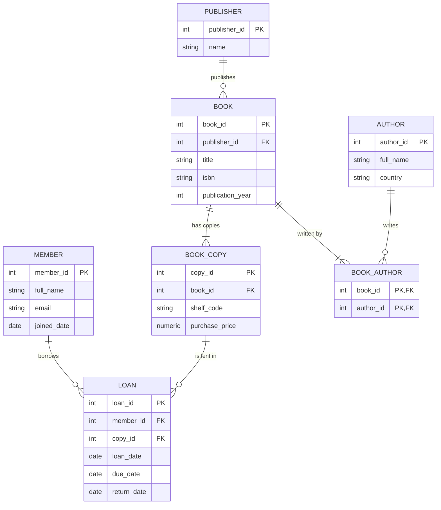

# ER Diyagramı: Mahalle Kütüphanesi

## Kardinaliteler

- Bir üye birçok ödünç alma (`loan`) yapabilir; her ödünç alma tek üyeye aittir (1:N).
- Bir kitabın (`book`) birden fazla fiziksel kopyası (`book_copy`) olabilir; her kopya tek kitaba aittir (1:N).
- Bir kopya zaman içinde birçok kez ödünç verilebilir (1:N).
- Bir yayınevi birçok kitap yayımlar; her kitabın tek yayınevi vardır (1:N).
- Kitap ve yazar arasında **çoktan çoğa (M:N)** ilişki vardır: bir kitabın birden fazla yazarı, bir yazarın birden fazla kitabı olabilir. Bu ilişki `book_author` ara tablosuyla kurulur.
