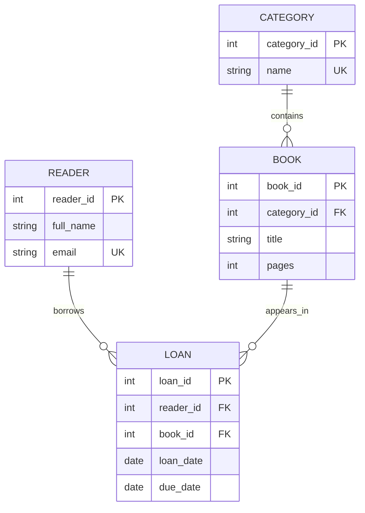

# Ödev 1 — ER diyagramı

Okuyucu ve kitap arasındaki M:N ilişki loan tablosuyla çözülür. Her ödünç kaydı bir okuyucu ve bir kitaba aittir. Aynı kitabın farklı tarihlerde yeniden ödünç alınması mümkündür.
