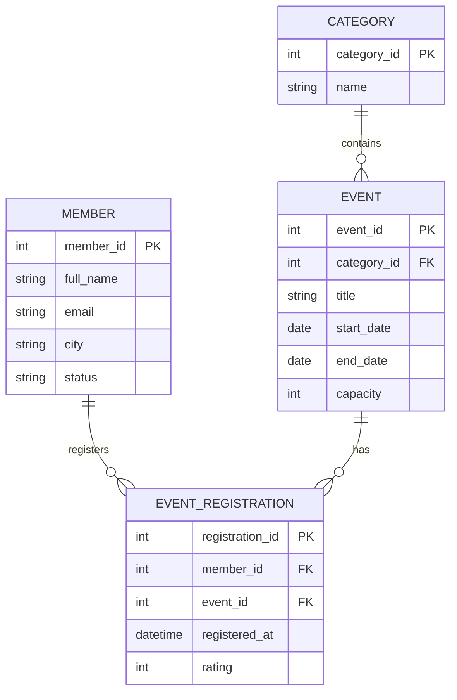

# ER Diagram

This system manages members registering for events in different categories. Each event belongs to one category. A member can register for many events, and an event can have many members. The many-to-many relationship between members and events is represented by event_registration.

