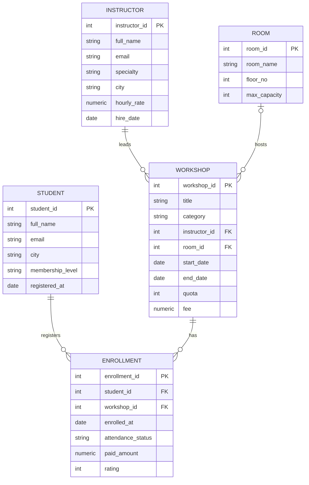

# ER Diyagramı — Kültür ve Sanat Merkezi Atölye Yönetim Sistemi

Aşağıdaki ER diyagramı, Kültür ve Sanat Merkezi Atölye Yönetim Sistemi'ndeki varlıkları, niteliklerini ve varlıklar arasındaki kardinalite kısıtlarını göstermektedir.

- Bir **eğitmen (`INSTRUCTOR`)** sıfır veya birden fazla **atölye (`WORKSHOP`)** verebilir; her atölyeyi tam bir eğitmen yönetir (`1:N`).
- Bir **stüdyo/salon (`ROOM`)** sıfır veya birden fazla **atölyeye (`WORKSHOP`)** ev sahipliği yapabilir; her atölye en fazla bir fiziksel salonda yapılır (`0..1:N`).
- Bir **kursiyer (`STUDENT`)** birden fazla **atölyeye (`WORKSHOP`)** kaydolabilir ve bir atölyeye birden fazla kursiyer katılabilir; bu çoktan-çoğa (`M:N`) ilişki **`ENROLLMENT`** ara tablosu ile modellenmiştir.

